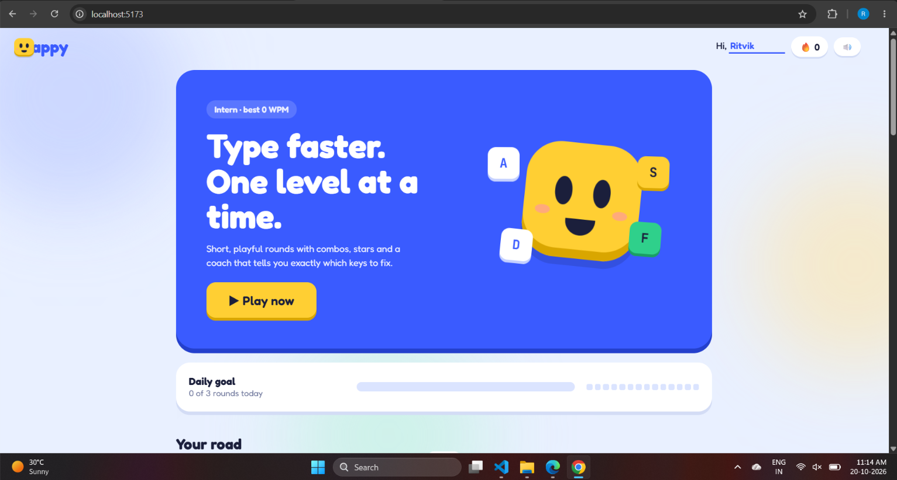
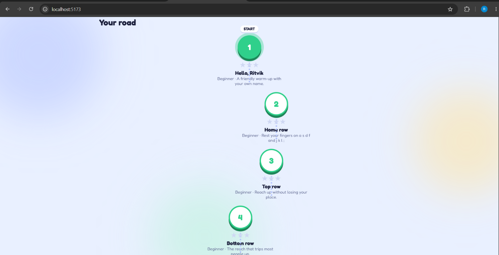
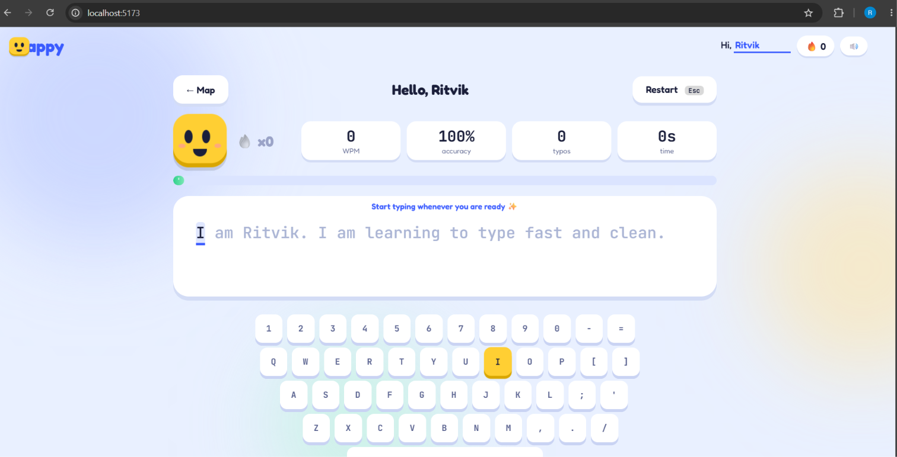
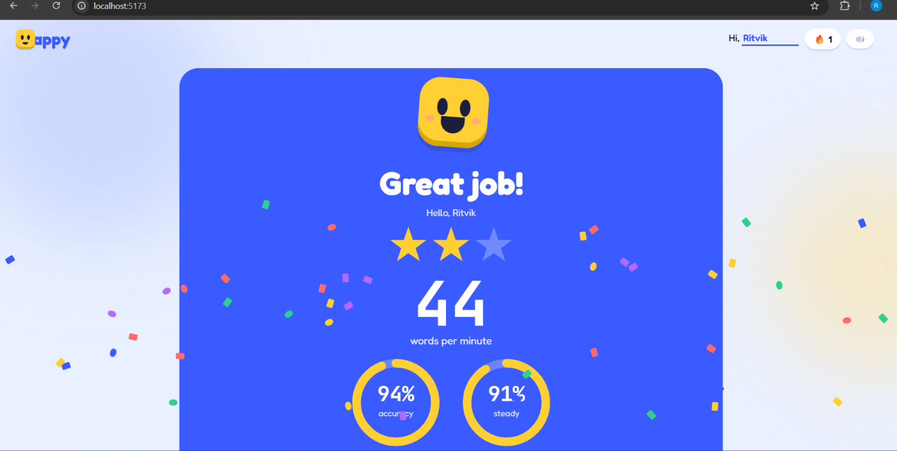
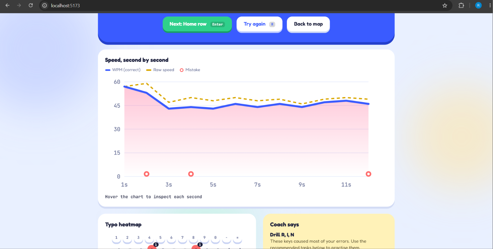

# Happy – Typing Practice ⌨️

Happy is a playful, level-based typing practice web app that helps users improve typing speed, accuracy, and consistency through short rounds and instant feedback.

## 📸 UI Screenshots

### 🏠 Home Page


### 🗺️ Level Map


### ⌨️ Typing Practice


### 🏆 Results


### 📊 Performance Analytics


## ✨ Features

- Personalized welcome message.
- Level-based typing lessons.
- Live words per minute (WPM) tracking.
- Real-time typing accuracy and typo statistics.
- Virtual keyboard with highlighted keys.
- Results summary with stars and performance metrics.
- Typing speed chart.
- Typo heatmap to identify difficult keys.
- Coach feedback with practice recommendations.
- Daily practice goals and streak indicator.
- Sound controls.
- Restart and map navigation.

## 🧰 Tech Stack

- React.js
- Vite
- JavaScript
- CSS

## 🚀 Getting Started

### Prerequisites

- Node.js (LTS recommended)
- npm

### Installation

1. Clone the repository:

   ```bash
   git clone https://github.com/YOUR-USERNAME/YOUR-REPOSITORY.git
   ```

2. Navigate to the project directory:

   ```bash
   cd YOUR-REPOSITORY
   ```

3. Install dependencies:

   ```bash
   npm install
   ```

4. Start the development server:

   ```bash
   npm run dev
   ```

5. Open the local URL displayed in the terminal. Vite commonly uses:

   `http://localhost:5173`

## 📦 Production Build

Build the application:

```bash
npm run build
```

Preview the production build:

```bash
npm run preview
```

## 🗂️ Project Structure

```text
keycraft/
├── screenshots/
│   ├── home.png
│   ├── level-map.png
│   ├── typing-practice.png
│   ├── results.png
│   └── performance-analytics.png
├── src/
├── README.md
├── index.html
└── package.json
```

## 🎯 Project Goal

Make typing practice enjoyable and effective by combining bite-sized lessons, instant feedback, and performance insights.

## 🤝 Contributing

Contributions and suggestions are welcome.

1. Fork the repository.
2. Create a new branch.
3. Make your changes.
4. Submit a pull request.

## 📄 License

No license has been specified yet. Add a LICENSE file if you want to publish the project under an open-source license.
